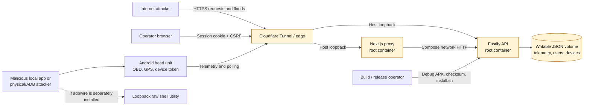

# OBD Telemetry Platform Security Audit

**Assessment date:** 2026-09-12

**Assessed revision:** `96eb8a40724161a69327f0939fe7cfc67bbedca6` (`main`, equal to `origin/main` at assessment time)

**Scope:** `Server/`, `Dashboard/`, `AndroidApp/`, `docker-compose.yml`, Dockerfiles, CI, APK distribution, and repository history

**Assessment type:** Independent source review, configuration review, dependency audit, local security probes, Android artifact inspection, and constrained-load benchmark

## 1. Executive summary

The platform has a sound authorization foundation, but it is **not ready for broad public self-deployment by novice operators**. No Critical vulnerability or unauthenticated cross-vehicle data bypass was verified. The overall risk is **High** because five material issues can expose an administrator credential, exhaust the service on modest hardware, replace the Android client through an unsafe release channel, or disclose historical secrets.

The strongest controls are worth preserving:

- API keys, device-token hashes, session tokens, and password hashes are compared with a constant-time helper (`Server/server.js:713-727, 918-945`).
- Passwords use Node `scrypt` with random 16-byte salts (`Server/server.js:699-710`).
- Browser sessions have 256-bit random identifiers, a separate CSRF token, a 24-hour expiry, and `HttpOnly; SameSite=Strict; Secure` cookies in production (`Server/server.js:827-873`).
- Cookie-authenticated mutations require the session-bound `x-csrf-token` (`Server/authorization.js:83-90`).
- Authorization is default-deny. Device credentials are restricted to telemetry, diagnostics, and their assigned vehicle; a local probe confirmed `403` responses for command and device-administration endpoints (`Server/authorization.js:33-45, 102-214`).
- Compose currently publishes the web and API ports only on `127.0.0.1`, and the main Android app has `allowBackup=false`.
- `npm audit` found no known production dependency vulnerability in either Node project at the assessed lockfiles.

The immediate release blockers are:

1. The server master key is still accepted as a browser password and Basic/API credential, while Android can store and display it. Its compromise grants full administration.
2. The public Next.js proxy buffers request and response bodies without an application limit, before its upstream timeout starts.
3. A vehicle-scoped device can grow the JSON store without quota and force full-array scans and synchronous whole-file rewrites. With 75,000 representative rows, the API process reached about 344 MiB RSS after one ingest operation.
4. The published installation flow builds and installs a debuggable APK signed with the Android debug certificate, and instructs operators to pipe a server-hosted script into `sudo bash`. The APK and checksum share the same trust boundary.
5. Credential-like values remain in Git history. Their rotation could not be proven; the repository must not be made public until they are revoked and history is cleaned.

### Threat model and trust boundaries



**Protected assets:** precise location and drive history, vehicle identifiers and diagnostics, device tokens, user sessions, the server master key, administrative commands, and Android release-signing identity.

**Principal attackers:** an unauthenticated Internet client, a compromised vehicle token, a malicious or compromised browser, a local app or person with head-unit access, a compromised deployment host, and a compromised APK/update origin.

**Material trust assumptions:** Cloudflare is the only public ingress; Docker host loopback is not bypassed; the deployment host and writable volume are trusted; operators protect `.env`; and Android installation artifacts are authentic. The repository does not contain the live Cloudflare configuration, so those assumptions were not verified against production.

## 2. Vulnerability matrix

| ID | Component | Severity | Title | Impact |
|---|---|---:|---|---|
| OBD-SEC-001 | Server / Android | **High** | Shared master key crosses client and admin boundaries | Theft of one value grants full server administration and all-vehicle access. |
| OBD-SEC-002 | Dashboard proxy | **High** | Unbounded public request buffering and authenticated response buffering | Remote memory exhaustion and connection-slot starvation in Next.js. |
| OBD-SEC-003 | Server persistence | **High** | Device-driven unbounded JSON growth and whole-store work | A compromised device can degrade or exhaust a 1 GB host and block the Node event loop. |
| OBD-SEC-004 | Android distribution | **High** | Debug-signed APK and root-piped same-origin installer | Origin compromise or release error can deliver attacker code with an unsafe installation workflow. |
| OBD-SEC-005 | Repository history | **High** | Historical credential-like values with unverified revocation | Publishing or cloning history may disclose still-valid administrative secrets. |
| OBD-SEC-006 | Android | **Medium** | Plaintext credentials and origin-switch credential forwarding | Physical/root/ADB access exposes tokens; a mistyped or malicious origin receives the saved credential. |
| OBD-SEC-007 | Pairing / sessions / logs | **Medium** | Bearer-capability values exposed in URLs and browser JSON | Reverse proxies, request logs, browser tooling, and extensions gain unnecessary access to reusable tokens. |
| OBD-SEC-008 | Cloudflare / rate limits | **Medium** | IP limits may collapse to the tunnel peer | One remote client can consume shared login or global buckets and deny service to others. |
| OBD-SEC-009 | Containers | **Medium** | Root containers without runtime resource containment | A service compromise has a larger container blast radius; memory or process exhaustion can affect the host. |
| OBD-SEC-010 | Telemetry validation | **Medium** | Physically impossible values can poison durable data and exports | A device can persist records that later cause `500` exports or corrupt analytics. |
| OBD-SEC-011 | Optional `adbwire` utility | **Medium** (conditional) | Unauthenticated local shell and unbounded ADB frame allocation | Any local app can run commands as the utility UID or crash it if the optional APK is installed. |
| OBD-SEC-012 | JSON startup loading | **Medium** | Parseable but structurally invalid stores can crash startup | Local tampering, partial operator edits, or corruption can produce a persistent restart loop. |
| OBD-SEC-013 | Android release controls | **Medium** | Target SDK 29, ignored release lint, and incomplete modern receiver/permission controls | Modern platform protections are missed and release-breaking security errors can pass CI. |
| OBD-SEC-014 | Authentication | **Low** | User lookup avoids password work for nonexistent users | Repeated timing measurements can help enumerate usernames. |
| OBD-SEC-015 | Dashboard | **Low** | No Content Security Policy | A future injection flaw would have fewer browser-side constraints. |
| OBD-SEC-016 | Android / logging | **Low** | Unprotected UI broadcasts and raw error-body logs | Local apps can spoof displayed state; diagnostic logs may retain backend details. |
| OBD-SEC-017 | Local data permissions | **Low** | Existing data files are group/world-readable | Other host users may read telemetry, accounts, or device metadata where directory traversal permits it. |

## 3. Detailed technical findings

### OBD-SEC-001 — Shared master key crosses client and admin boundaries

**Evidence.** `authenticateRequest` treats `X-API-Key` and a Basic-auth password equal to `OBD_API_KEY` as `type: master` (`Server/server.js:918-923, 963-973`). `/api/auth/login` accepts the same key as the password for any supplied username and creates a master session (`Server/server.js:2688-2701`). `authorization.js:4-8` maps master authentication to the administrative principal. Android persists an `API_KEY` and exposes configuration that can display or submit it (`AndroidApp/app/src/main/java/com/example/obdapp/ApiConfig.kt:19-32, 54-63`; `MainActivity.kt:195-207`; `view_api_config_card.xml:46-62`).

**Exploitation.** A person, malicious local app, diagnostic backup, screen observer, or compromised head unit obtains the key. The attacker can use it directly through `X-API-Key`, Basic authentication, or browser login, then administer users/devices and access every vehicle. The code correctly uses constant-time comparison; the failure is the privilege and distribution of the shared secret.

**Recommendation.** Remove master-key browser and Basic login. Keep any bootstrap/operator secret server-side only, rotate it after bootstrap, and require named administrative accounts. Android must retain only a vehicle-scoped device token. Migrate existing clients by pairing, then delete the legacy key from preferences and the configuration UI.

### OBD-SEC-002 — Unbounded public buffering in the Dashboard proxy

**Evidence.** `Dashboard/pages/api/[...path].ts:3, 23-29` disables Next body parsing and concatenates the entire inbound stream with `Buffer.concat`. The upstream timeout is established only after collection. The same handler accumulates every upstream response chunk before sending it. `/api/auth/login` is intentionally public in `Dashboard/proxy.ts:5-10`.

**Exploitation.** An unauthenticated client slowly uploads or streams a very large login request. Memory grows before the backend's Fastify body limit can apply, and the configured upstream timeout does not cover that phase. An authenticated request to an uncapped history/export route can also make the proxy hold the full backend response. Concurrent requests can terminate or stall the Next container.

**Recommendation.** Enforce `Content-Length` and a counted streaming ceiling before allocation, start one total request deadline before reading, abort on disconnect, and return `413`. Stream upstream responses with backpressure instead of buffering. Apply smaller limits to login and pairing routes at Cloudflare as well as in Next.

Example counted reader:

```ts
async function readLimited(req: NextApiRequest, maxBytes: number) {
  const declared = Number(req.headers['content-length'] ?? 0)
  if (declared > maxBytes) throw new PayloadTooLargeError()
  const chunks: Buffer[] = []
  let total = 0
  for await (const chunk of req) {
    total += chunk.length
    if (total > maxBytes) throw new PayloadTooLargeError()
    chunks.push(chunk)
  }
  return Buffer.concat(chunks, total)
}
```

### OBD-SEC-003 — Device-driven unbounded JSON growth and whole-store work

**Evidence.** `/api/telemetry/batch` has no `maxItems` (`Server/server.js:1555-1599`). Each ingest reconstructs a deduplication set from all prior records, concatenates a full candidate array, and synchronously commits the whole JSON file (`Server/server.js:631-648, 1640-1659`). `/api/telemetry/history` returns an uncapped date range and accepts an arbitrary positive `limit` (`Server/server.js:2123-2148`). `/api/telemetry/changes` clones and sorts the full store per request (`Server/server.js:2162-2188`). A device token is authorized to ingest for its vehicle (`Server/authorization.js:114-119`).

**Measured result.** A disposable local benchmark with 75,000 representative records produced a 43.7 MiB JSON file. Process RSS was approximately 171 MiB at readiness, 286 MiB after an uncapped 32.5 MiB history response, and 344 MiB after ingesting 100 more rows. The synchronous ingest took approximately 171 ms. These values are directional local measurements, but they establish a practical risk on the stated 1 CPU / 1 GB target.

**Exploitation.** A stolen device token continuously submits valid batches. Disk use, startup parsing, deduplication, response serialization, and synchronous rewrites grow with the total dataset. One device can degrade all users and increase the probability of an out-of-memory termination or disk exhaustion.

**Recommendation.** Immediately cap batch rows, record size, history page size, date span, and per-device ingest rate/byte budget. Add retention and disk watermarks. Replace whole-file JSON persistence with SQLite WAL or another transactional store, using an indexed unique key on `(vehicle_id, event_id)` and an index on `(vehicle_id, ingest_seq, timestamp)`. Paginate all exports and change feeds or stream them from indexed queries.

```js
body: { type: 'array', minItems: 1, maxItems: 100, items: telemetryRecordSchema }
// Reject limit outside 1..5000 and restrict date ranges.
```

### OBD-SEC-004 — Debug APK and unsafe root installation chain

**Evidence.** The existing distributed artifact is `app-debug.apk`; local inspection identified it as `application-debuggable` and signed with the standard Android Debug certificate. The Makefile invokes `assembleDebug` and stages that artifact. The server publishes both APK metadata/checksum and APK without authentication (`Server/server.js:3175-3224`). It also serves an installer explicitly intended for `curl ... | sudo bash` (`Server/server.js:3227-3246`). CI skips Android artifact validation successfully when the files are absent (`.github/workflows/ci.yml:65-67`).

**Exploitation.** An operator's first installation accepts a debug-signed package. A compromise of the distribution server can alter the root-executed shell script and the APK/checksum together. For an existing installation, Android signing normally blocks a mismatched update, but the root installer can uninstall/replace the app or execute arbitrary commands itself. The checksum detects transport corruption, not a compromised origin.

**Recommendation.** Build `assembleRelease` with a protected, stable signing key; CI must fail if the APK is debuggable, debug-signed, missing, or version metadata mismatches. Publish signed release metadata from a separate protected signing step. Replace the pipe-to-root instruction with a downloaded, versioned script whose detached signature is verified before execution; minimize or remove root. Drop `pm install -t` from production installation.

### OBD-SEC-005 — Historical credential-like values

**Evidence.** Commit `685ad1a3` contains non-placeholder credential-like literals in the historical Android `ApiConfig.kt` and Dashboard middleware. The current files no longer contain those values, and the repository was private during the assessment. Revocation could not be confirmed without using the secrets.

**Exploitation.** Anyone who receives the Git history after publication, through a clone, mirror, cache, or archive can recover the old values. If either remains valid, the impact follows its original privilege, including potential server administration.

**Recommendation.** Rotate and revoke first. Confirm the old values fail without logging them. Then rewrite history with `git filter-repo` or BFG in a coordinated maintenance window, force-update all refs, invalidate old clones/caches, and scan every branch/tag before changing repository visibility.

### OBD-SEC-006 — Plaintext Android credentials and origin-switch forwarding

**Evidence.** `ApiConfig.kt:19-47` stores both API key and device token in ordinary `SharedPreferences`. `ApiConfig.kt:54-63` selects the saved device token or API key after resolving the mutable base URL. `MainActivity.kt:195-207` accepts either HTTP or HTTPS and retains an existing key if the key field is blank. The local Room database is not encrypted and contains GPS telemetry (`AppDatabase.kt:143-147`; `TelemetryDatabase.kt:28-31`). The app's `allowBackup=false` is a useful mitigation, but it does not protect a rooted/userdebug/ADB-compromised head unit.

**Exploitation.** Physical or privileged local access reads the preferences/database. Separately, an operator who changes the endpoint to an attacker-controlled HTTPS origin sends the existing bearer credential there on the next request. On API 23-27, configured HTTP is permitted by platform defaults; on API 28+ it is normally blocked and instead causes failure.

**Recommendation.** Use an Android Keystore-backed AEAD key for tokens, bind stored tokens to a canonical HTTPS origin, and require explicit re-pairing when the origin changes. Remove HTTP from UI validation and add a network security configuration that disables cleartext for every supported API. Decide whether local telemetry needs database encryption based on the head-unit threat model; at minimum, implement bounded retention and a user-visible erase function.

### OBD-SEC-007 — Bearer capabilities in URLs and browser JSON

**Evidence.** Pairing polling uses a `pollToken` query parameter (`Server/server.js:2934-2959`). The production logger is enabled (`Server/server.js:8-10`); a disposable probe confirmed the request URL, including the synthetic poll token, appears in the default log. Pairing claim returns the raw device token to the browser (`Server/server.js:3083-3089`). Login responses return the session bearer token even though a secure cookie is also set (`Server/server.js:2694-2701, 2724-2726`).

**Exploitation.** URL tokens propagate to reverse-proxy/request logs and observability systems. Browser-returned bearer values are accessible to JavaScript, extensions, devtools, and client-side error capture. Each copy increases the chance of replay until expiry or revocation.

**Recommendation.** Poll with `POST` and carry the token in the body or a dedicated header; configure structured log redaction for authorization, cookies, pairing fields, and query strings. Deliver a claimed device token directly to the pairing client or show it once through a tightly scoped route, not a general browser response. If browser auth uses an `HttpOnly` cookie, omit the session token from JSON.

### OBD-SEC-008 — Tunnel-collapsed IP rate limiting

**Evidence.** `@fastify/rate-limit` is global and uses the request IP by default (`Server/server.js:1507-1512`). Compose sets `OBD_TRUST_PROXY=false`, while the documented topology places Cloudflare Tunnel in front of the loopback service. In that arrangement, Fastify sees the tunnel peer unless trusted-proxy handling or an edge-derived key is configured.

**Exploitation.** All public clients may share one rate-limit identity. One unauthenticated source can exhaust the login or global bucket and cause `429` responses for legitimate users. Blindly trusting arbitrary forwarded headers would create the opposite bypass, so a generic `trustProxy=true` is unsafe.

**Recommendation.** Trust only the exact local proxy hop, derive the address from `CF-Connecting-IP` only when the immediate peer is the local tunnel, and add account/device keyed limits. Enforce complementary login, body-size, and burst limits at Cloudflare.

### OBD-SEC-009 — Root containers without containment

**Evidence.** Neither Dockerfile declares `USER`. Compose lacks `read_only`, `cap_drop`, `security_opt: no-new-privileges`, PID limits, or CPU/memory limits. The API needs a writable data volume, but the remaining filesystem need not be writable. Host ports are correctly loopback-bound in the current revision.

**Exploitation.** Code execution in either service starts with container root. Container isolation still provides a boundary, but excessive Linux capabilities and writable filesystem scope increase post-exploitation options. Application-level memory or process exhaustion can also consume host resources without Compose limits.

**Recommendation.** Create an unprivileged runtime user, pre-own only the data directory, use a read-only root filesystem with `tmpfs` for required temporary paths, drop all capabilities, enable `no-new-privileges`, and set memory/CPU/PID ceilings.

```yaml
services:
  server:
    user: "10001:10001"
    read_only: true
    tmpfs: [/tmp]
    cap_drop: [ALL]
    security_opt: [no-new-privileges:true]
    pids_limit: 128
    mem_limit: 512m
    cpus: 0.75
```

### OBD-SEC-010 — Durable telemetry poisoning

**Evidence.** Numeric schema fields have types but no realistic ranges (`Server/server.js:1555-1583`). A disposable authenticated device-token probe submitted an extreme timestamp/coordinates successfully (`201`), after which drive export returned `500`. Exporters call `new Date(...).toISOString()` and interpolate values into CSV/GPX (`Server/server.js:1996-2069`).

**Exploitation.** A compromised device persists syntactically valid but impossible values. Later reads, analytics, or exports fail or mislead operators. Because the bad record is durable, the error survives restart.

**Recommendation.** Enforce finite values and domain ranges: timestamp within an allowed clock-skew window; latitude `-90..90`; longitude `-180..180`; nonnegative RPM/speed; bounded temperatures, voltage, and percentages. Reject rather than coerce. Escape CSV formula prefixes and XML content where string fields are later added. Add quarantine tooling for existing invalid rows.

### OBD-SEC-011 — Optional `adbwire` local shell and parser allocation

**Evidence.** The module is included only with `includeAdbwire=true` or `OBD_INCLUDE_ADBWIRE=true`, and its release variant is disabled (`AndroidApp/settings.gradle.kts:36-38`; `adbwire/build.gradle.kts:34-38`). The normal app has no dependency on it. If separately installed, it exposes unauthenticated loopback ADB and raw shell services and invokes `/system/bin/sh` (`AdbServer.kt:24-64, 219-285`). Android loopback is shared between apps. `AdbProtocol.kt:79-108` allocates `ByteArray(dataLength)` before bounding the peer-controlled length.

**Exploitation.** Another local app connects to ports 5555/7777 and executes commands with the utility application's UID. A negative or very large ADB frame length can crash or exhaust the utility. This is not remote root and is not present in the main APK, but it is dangerous on any device where the utility is installed.

**Recommendation.** Do not distribute it to end users. If it must exist, authenticate clients, remove the raw shell, validate `0 <= dataLength <= MAX_PAYLOAD` before allocation, limit connections/threads, use a distinct debug-only application ID, and add CI assertions that no release bundle contains the package or artifacts.

### OBD-SEC-012 — Structurally invalid JSON can crash startup

**Evidence.** Store loading parses JSON but does not consistently validate that every file has its expected array/object schema (`Server/server.js:339-410`). Startup immediately iterates and stamps loaded stores (`Server/server.js:576-584`) and performs migrations. A syntactically valid object in place of an array can therefore throw persistently on each restart.

**Exploitation.** This requires local volume access, a faulty restore, or corruption rather than an Internet request. Once present, the malformed store prevents service recovery until an operator repairs the file.

**Recommendation.** Validate every store against a versioned schema before assigning globals. On failure, fail with a precise filename and recovery instruction, preserve the original, and optionally restore only from a verified backup. Never silently discard security-sensitive users/devices data.

### OBD-SEC-013 — Android release controls lag current platform requirements

**Evidence.** The app targets API 29 (`AndroidApp/app/build.gradle.kts:13`), disables release lint failure (`:24-33`), and has no release signing configuration. Current lint reports 5 errors and 321 warnings while the build remains successful; errors include missing `BLUETOOTH_CONNECT` checks, and a warning identifies an unspecified dynamic receiver export flag (`MainActivity.kt:622, 632, 733`). Google Play's current requirement for new apps and updates is API 36, with a separate API 35 rule for Automotive OS.

**Impact.** The app misses behavior and security enforcement introduced for modern targets. Permission paths can fail at runtime on newer devices, and CI can publish despite security-relevant lint errors.

**Recommendation.** Raise `targetSdk` to the applicable current level, migrate Bluetooth and staged background-location permissions, register internal broadcasts with `RECEIVER_NOT_EXPORTED`, enable release lint failure, and add a signed release build to CI. Preserve `minSdk` if older head units must remain supported.

### OBD-SEC-014 — Username timing enumeration

**Evidence.** Login only performs expensive `scrypt` verification after finding a user (`Server/server.js:975-977` and the login handler). A nonexistent username returns without equivalent password work.

**Recommendation.** Keep one fixed dummy salt/hash and perform the same asynchronous `scrypt` operation for missing users. Preserve the generic error response and account-specific throttling.

### OBD-SEC-015 — Missing Content Security Policy

**Evidence.** `Dashboard/next.config.js:5-35` sets HSTS, frame, MIME-sniffing, referrer, and permissions headers but no CSP.

**Recommendation.** Deploy `Content-Security-Policy-Report-Only` first, measure required Next.js sources/nonces, then enforce a nonce-based policy with `object-src 'none'`, `base-uri 'self'`, `frame-ancestors 'none'`, and narrow `connect-src`/`img-src` directives.

### OBD-SEC-016 — UI broadcast spoofing and release log exposure

**Evidence.** `MainActivity.kt:728-734` dynamically registers telemetry/status actions without `RECEIVER_NOT_EXPORTED`; another local app can send matching broadcasts to the foreground activity. `OutboxUploader.kt:312, 362, 418, 471` logs raw error response bodies, and release minification/log stripping is disabled.

**Recommendation.** Use `ContextCompat.registerReceiver(..., RECEIVER_NOT_EXPORTED)` or an in-process `StateFlow`. Remove response bodies, identifiers, coordinates, and tokens from production logs; retain only a request correlation ID, status class, and bounded sanitized error code.

### OBD-SEC-017 — Existing local stores have permissive modes

**Evidence.** The assessed `Server/data/*.json` files were mode `0644`. New transaction writes request `0600`, but existing files are not normalized at startup. Directory permissions were not relied on as a compensating control.

**Recommendation.** Run the service as a dedicated UID, make the data directory `0700`, normalize files to `0600` at startup/migration, and document ownership repair for existing installations. Encrypt backups and exclude them from web roots and support bundles.

## 4. Actionable remediation plan

### P0 — Before any public release or novice self-deployment

1. **Remove the shared master key from client flows.** Disable key-as-password and Basic master authentication; pair Android to a single vehicle token; migrate and erase legacy Android key storage; rotate the master key and invalidate sessions.
2. **Bound every gateway and API payload.** Add route-specific inbound limits in Next and Fastify, one total deadline, disconnect cancellation, streaming/backpressure for downloads, maximum history range/page size, and edge limits.
3. **Stop whole-file telemetry growth.** Enforce per-device quotas and retention immediately; migrate telemetry and change cursors to SQLite WAL with indexes and bounded queries. Keep the existing transaction journal until migration durability tests pass.
4. **Create a real Android release chain.** Protected signing key, non-debuggable `assembleRelease`, mandatory CI artifact checks, signed metadata, reproducible versioning, and a verified installer that does not pipe network content to a root shell.
5. **Rotate and remove historical secrets before changing repository visibility.** Revoke, verify revocation, rewrite all refs, rescan branches/tags/artifacts, then coordinate fresh clones.
6. **Add release-blocking regression tests.** Cover oversized/slow proxy bodies, maximum telemetry batches, invalid numeric values, capped history, device denial of admin routes, non-debug APK signing, and absence of `adbwire` from release outputs.

### P1 — Short-term security engineering

1. Store Android tokens with a Keystore-backed AEAD key, bind them to an HTTPS origin, and clear/revoke on origin change. Add explicit cleartext denial for all supported Android versions.
2. Move pairing tokens out of URLs, redact secrets/query values from logs, and stop returning cookie session tokens in JSON.
3. Configure exact-hop proxy trust and layered limits keyed by client IP, username, session, and device identity.
4. Run containers as non-root with a read-only root filesystem, dropped capabilities, `no-new-privileges`, resource/PID limits, and tightly owned volumes.
5. Add versioned schema validation and safe recovery for every persistent store; normalize file modes.
6. Enforce realistic telemetry ranges and create an operator tool to locate/quarantine existing invalid data.
7. Raise the Android target SDK, split permission requests correctly, make internal receivers non-exported, and make release lint errors fatal.
8. Remove the optional shell utility from distribution. If developers retain it, add authentication and strict frame/connection bounds.

### P2 — Defense in depth and operational hardening

1. Equalize login work for missing users, require longer initial passwords, add MFA for administrators, and introduce idle plus absolute session expiry.
2. Roll out CSP, use a `__Host-` session-cookie name, and keep CSRF tokens fixed-length and constant-time compared.
3. Pin container base images by digest, generate an SBOM, scan images in CI, and automate dependency updates.
4. Define telemetry retention, export, deletion, encrypted backup, and incident-revocation procedures suitable for precise location data.
5. Add structured security audit events for login, pairing, token rotation, administrative changes, export, and repeated ingest rejection without logging secrets.
6. Keep health/version endpoints minimal; expose operational counts only to authenticated monitoring when they reveal fleet size or activity.

## 5. Verification performed

| Check | Result |
|---|---|
| Git baseline | Clean `main`; `HEAD` matched `origin/main` at `96eb8a4` before report creation. |
| Server tests | 12 suites, 84 tests passed. |
| Server production dependency audit | 0 known vulnerabilities reported by `npm audit --omit=dev`. |
| Dashboard lint/build | Passed; Next.js production build completed. |
| Dashboard dependency audit | 0 known vulnerabilities reported by `npm audit`. |
| Android unit task | Successful/up-to-date in Gradle. |
| Android lint | Build completed but report contained 5 errors and 321 warnings because release lint is configured not to fail. |
| APK inspection | Existing debug APK is debuggable and Android-debug signed. |
| Authorization probe | Master-key login produced admin; device token received `403` on command and device-admin routes. |
| Data validation probe | Extreme telemetry was accepted (`201`) and later caused export `500`. |
| Logging probe | Synthetic pairing poll token appeared in request URL logs. |
| 75k-row benchmark | 43.7 MiB data; approximately 171 MiB ready RSS, 286 MiB after history, 344 MiB after ingest. |
| External independent reviews | Read-only Server review with EVOT; read-only Android review with AGY Gemini 3.8 Flash Medium; findings manually reconciled with current source. |

## 6. Limitations

- No production system, live vehicle, real credentials, Cloudflare account/configuration, DNS policy, host firewall, volume mount options, or hardware keystore was accessed.
- No container image scanner was available; dependency audits do not cover Alpine OS packages or every supply-chain compromise.
- The load benchmark was local and synthetic, not a capacity test under production concurrency.
- Historical secret validity was deliberately not tested. Rotation and revocation status remains an operator verification item.
- Passing tests establish expected behavior for covered cases; they do not remove the design risks described above.

## 7. Reference standards

- [Node.js crypto documentation](https://nodejs.org/api/crypto.html) — `timingSafeEqual`, `scrypt`, and salt guidance.
- [Fastify server limits](https://fastify.dev/docs/latest/Reference/Server/) — default backend `bodyLimit` behavior.
- [Fastify rate-limit](https://github.com/fastify/fastify-rate-limit) — default IP-based key behavior.
- [Android Keystore](https://developer.android.com/privacy-and-security/keystore) and [Network Security Configuration](https://developer.android.com/privacy-and-security/security-config).
- [Android app signing](https://developer.android.com/studio/publish/app-signing) and [Google Play target API requirements](https://developer.android.com/google/play/requirements/target-sdk).
- [Docker Engine security](https://docs.docker.com/engine/security/) and [rootless mode](https://docs.docker.com/engine/security/rootless/).
