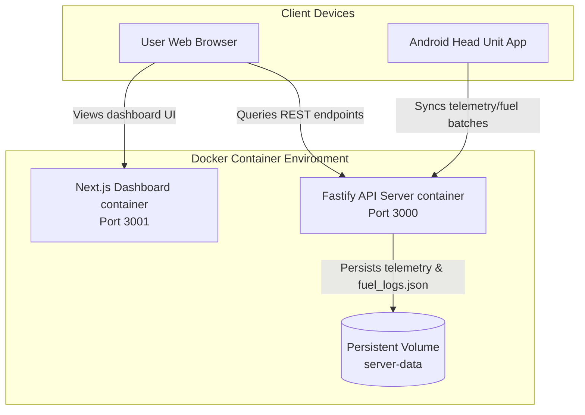

# OBD2 Telemetry Server & Dashboard: Deployment Guide

This guide outlines how to build, deploy, and manage the OBD2 Telemetry backend server and Next.js monitoring dashboard on a remote Linux server using **Docker Compose**.

---

## 1. Architecture Overview

The system consists of two primary Dockerized services orchestrating together:



*   **Fastify API Server (Port 3000)**: Ingests raw telemetry and fuel logs from the mobile head unit, performs statistics calculations, and serves REST routes.
*   **Next.js Dashboard (Port 3001)**: Renders the frontend time-series charts, Leaflet GPS maps, and refueling analytics tables.
*   **Volume (`server-data`)**: Persists local flat JSON records (`fuel_logs.json`) and database files, ensuring data survives container updates.

---

## 2. Prerequisites

Ensure your host server has the following installed:
1.  **Docker** (v20.10+)
2.  **Docker Compose** (v2.0+)
3.  **Git** (for cloning the repository)

Verify with:
```bash
docker --version
docker compose version
```

---

## 3. Deployment Steps

### Step 1: Clone the Repository
On your server, clone your private GitHub repository. You will need a **GitHub Personal Access Token (PAT)** or SSH keys configured:
```bash
git clone https://github.com/hon2838/obd-telemetry-app.git
cd obd-telemetry-app
```

### Step 2: Configure Environment Variables
Create a `.env` file in the root directory to customize the public URL of the Fastify API so the browser knows where to request charts:

```env
# The public domain or IP of the host server running the API on port 3000
NEXT_PUBLIC_API_URL=http://your-server-ip:3000
```
> [!NOTE]
> If you do not specify `NEXT_PUBLIC_API_URL`, the dashboard will automatically fallback to the user's browser domain name on port `3000` (e.g. `http://<domain-accessed>:3000`), which is ideal for zero-config LAN deployments.

### Step 3: Run Docker Compose
Start the services in detached mode (background):
```bash
docker compose up -d --build
```
This command will:
1.  Compile the lightweight Node Alpine images for both projects.
2.  Generate the static Next.js pages optimized for production.
3.  Configure persistent storage binding for logs.
4.  Bind ports `3000` and `3001` to the host machine.

### Step 4: Verify Containers are Healthy
Check the status of the containers:
```bash
docker compose ps
```

You should see both containers running:
```text
NAME                         IMAGE                        COMMAND                  SERVICE             CREATED             STATUS              PORTS
obd-telemetry-app-dashboard  obd-telemetry-app-dashboard  "docker-entrypoint.s…"   dashboard           10 seconds ago      Up 9 seconds        0.0.0.0:3001->3001/tcp
obd-telemetry-app-server     obd-telemetry-app-server     "docker-entrypoint.s…"   server              10 seconds ago      Up 9 seconds        0.0.0.0:3000->3000/tcp
```

---

## 4. Cloudflare Tunnel Setup (Recommended for Production)

To securely expose the dashboard and API without port-forwarding, configure a **Cloudflare Tunnel (`cloudflared`)** with two separate subdomains.

### 1. Configure DNS and .env
Decide on your subdomains (e.g. `obd.yourdomain.com` for Dashboard, and `obd-api.yourdomain.com` for API).
Before building your Docker containers, set the API URL in your `.env` file:
```env
NEXT_PUBLIC_API_URL=https://obd-api.yourdomain.com
```

### 2. Configure Cloudflared Ingress
If using a local `config.yml` (e.g., `/etc/cloudflared/config.yml`), set up your ingress rules to point the two subdomains to the respective ports:

```yaml
tunnel: <YOUR-TUNNEL-UUID>
credentials-file: /root/.cloudflared/<YOUR-TUNNEL-UUID>.json

ingress:
  - hostname: obd-api.yourdomain.com
    service: http://localhost:3000
  - hostname: obd.yourdomain.com
    service: http://localhost:3001
  - service: http_status:404
```
*Note: If your dashboard is bound to port 3003 instead due to port conflicts, change `localhost:3001` to `localhost:3003` above.*

Restart your cloudflared service:
```bash
sudo systemctl restart cloudflared
```

### 3. Route DNS
Route both subdomains to your tunnel:
```bash
cloudflared tunnel route dns <YOUR-TUNNEL-UUID> obd.yourdomain.com
cloudflared tunnel route dns <YOUR-TUNNEL-UUID> obd-api.yourdomain.com
```

---

## 5. Mobile App Setup (Client Connection)

Once the server is running publicly:
1.  Open the **OBD Telemetry App** on the Android Head Unit.
2.  Locate the **Custom Endpoint URL** input under **API SERVER CONFIG**.
3.  Enter the URL of your server's endpoint:
    *   **Direct IP deployment**: `http://<your-server-ip>:3000/api/telemetry/batch`
    *   **SSL Reverse Proxy deployment**: `https://obd.yourdomain.com/api/telemetry/batch`
4.  Tap **START SERVICE** to start synchronization.

---

## 6. Logs & Maintenance

### Check Container Logs
View live service logs:
```bash
# All services
docker compose logs -f

# API Server only
docker compose logs -f server
```

### Backup Data
All data ingested is stored inside a Docker volume. To find the path on the host system:
```bash
docker volume inspect obd-telemetry-app_server-data
```
This is typically located under `/var/lib/docker/volumes/obd-telemetry-app_server-data/_data`. You can set up a daily cronjob to compress and back up this directory:
```bash
tar -czf /backups/obd-data-$(date +%F).tar.gz /var/lib/docker/volumes/obd-telemetry-app_server-data/_data
```
