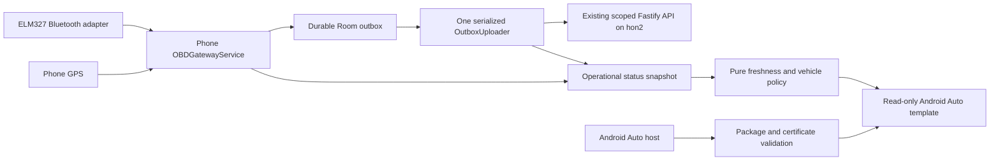

# Android Auto phone projection

The `androidauto` flavor adds a phone application, `com.example.obdapp.androidauto`, named **OBD Connect**. The existing `standard` head-unit package stays `com.example.obdapp`. The unrelated `amapauto` compatibility flavor is not Android Auto projection and is not used by these build targets.

## Product boundary

The first projected screen shows three connected-device states: OBD adapter connection, GPS fix availability, and cloud upload state. There are no car-screen pairing, vehicle-selection, diagnostics, DTC-clear, gauges, charts, or settings controls. Setup and collection startup happen on the phone while parked. Projection never starts a second collector or uploader and does not require the cloud to render existing device status.

This is an experimental connected-device status implementation using the IoT category. Google's current guidance permits viewing device state in that category, but does not explicitly confirm eligibility for OBD telemetry. Do not describe this build as Google Play approved or expand it into a live telemetry dashboard under an unrelated category. Category eligibility and the applicable car-quality requirements must be reviewed before distribution.

## Architecture and engineering controls



- The projected screen consumes bounded operational state, not raw telemetry, precise coordinates, secrets, or command queues. Bluetooth, network transport, and database access remain in the existing background components.
- Screen refresh runs on the main dispatcher only while started, every three seconds. It invalidates only when displayed state changes. Jobs cancel when the screen stops or is destroyed.
- Adapter samples expire after 15 seconds. GPS uses the actual fix's monotonic timestamp and the collector's 10-second coordinate window. Sync status expires after two minutes. Switching vehicles hides another vehicle's status. New samples change a previously synced state back to queued.
- Upload errors are attributed to the vehicle whose batch failed across telemetry, fuel, and maintenance. Another vehicle's failed upload does not overwrite the active vehicle's successful status; global retry/backoff still applies and unacknowledged rows remain queued.
- Release hosts are validated by package and signing certificate using the Car App Library's maintained host allowlist. Permissive host validation is limited to debuggable builds for development.
- The phone flavor targets SDK 36 and declares modern Bluetooth and foreground-service permissions. Startup is initiated from the visible phone activity. Background location and boot-start are excluded from this flavor. The head-unit flavor retains its prior permission contract.
- Collection is marked running only after Android accepts foreground promotion. Permission or background-start rejection stops startup safely, preserves an actionable stopped message, and prevents a later start callback from launching collection. A Bluetooth socket-close failure cannot interrupt the remaining shutdown cleanup.
- Runtime broadcasts are not exported on modern Android. Phone screens account for system bars and the keyboard under enforced edge-to-edge rendering.
- The backend remains the authorization boundary: existing vehicle-scoped device tokens, request limits, idempotent upload acknowledgments, and durable command semantics are reused. No new public endpoint or privilege was introduced for projection.

## Build and local verification

From the repository root, with JDK 17 and Android SDK 36:

```sh
make apk-androidauto
make test-android
cd AndroidApp
./gradlew :app:assembleAndroidautoRelease :app:lintAndroidautoDebug --no-daemon
python3 scripts/check_androidauto_validation.py
```

The debug APK is `AndroidApp/app/build/outputs/apk/androidauto/debug/app-androidauto-debug.apk`. The release output is unsigned until the deployment owner supplies signing configuration. Never commit signing keys or account credentials. The server's `make apk-bundle` deliberately packages the standard head-unit APK, not this phone package.

Tests cover freshness, future timestamps, stopped collection, vehicle changes, sync transitions, phone/head-unit permission policies, the actual three-row template, setup messaging, and restricted release-host configuration. CI builds both variants and the phone release variant. Local tests do not establish real Bluetooth, Android permission-dialog, projection, or car-host behavior.

Robustness regressions exercise the actual uploader with Room and a loopback HTTP server, including active-vehicle success followed by another vehicle's failure, retained rows, and unchanged global retry behavior. ScreenController tests cover expiry without new samples, pause/resume, and teardown. A host using an allowlisted package name with the wrong certificate is rejected. Foreground-start rejection and socket cleanup tests inject OS failures under Robolectric; they do not substitute for Android 14/16 device acceptance tests.

Current Android validation passed 49 standard Android tests and 61 phone-flavor Android tests. Earlier backend/dashboard validation passed 135 backend tests on Node 24 and 12 browser/session tests; those components were unchanged by this robustness follow-up. Both debug variants and the unsigned phone release built successfully; dashboard type checking and production build also passed. Android lint retains one fatal target-SDK finding at the deliberately preserved head-unit default of 29. The separate validation gate verifies both merged phone manifests target 36 and rejects every other lint error, so the existing non-blocking legacy lint policy cannot silently accept new phone errors. This is a documented legacy exception, not a clean lint report.

## Phone and Desktop Head Unit acceptance checks

1. Install the debug APK on a test phone. Pair the ELM327 adapter in Android settings. In OBD Connect, choose the vehicle and adapter, pair a vehicle-scoped cloud identity, grant the requested permissions, and press Start while the phone app is visible.
2. Use one OBD collector for that vehicle. A head-unit collector and phone collector may compete for the adapter or independently create duplicate physical measurements with different event IDs.
3. Follow Google's Desktop Head Unit instructions to enable Android Auto development and launch the host. A phone running Android Auto is required; a car is not required for this step. Do not apply sideloading or host-validation development settings to a release build.
4. Verify the setup message, connected/disconnected adapter states, stale GPS rejection, offline recording, successful reconnection/upload, session disconnect/reconnect, and vehicle switching.
5. Test actual runtime permission denial/revocation on Android 12, 14, and 16 phones and verify foreground collection remains stable after leaving the phone UI. Test stopped collection and phone process death without stale status on the car screen.
6. Review Android Auto quality and category eligibility, release signing, credential protection, dependency advisories, accessibility, and physical adapter behavior before public release. Current credentials retain the existing app-private SharedPreferences implementation; Android Keystore protection is a remaining hardening task.

## Server capacity and optimization follow-up

Read-only host checks on 2026-10-04 found OBD already healthy on hon2: 2 vCPUs, 954 MiB RAM, roughly 436 MiB available, 28 GiB disk free, Node 24.21.0, backend RSS about 117 MiB, dashboard about 43 MiB. Hon1 had roughly 331 MiB available and already ran Server Pulse, PostgreSQL, and another API service. These are momentary measurements, not capacity guarantees. Keep OBD on hon2 and build images/APKs on the laptop.

Production uses JSON and has 136,194 records in an approximately 84.8 MiB telemetry file. Current ingestion rewrites the complete file for new records. A local Node 24 benchmark, capped at one CPU and 512 MiB, measured 100-row batches at about 0.27–0.42 seconds with 75,000 synthetic records and 0.50–0.86 seconds with 150,000. At 75,000 records, SQLite batches after warm-up took roughly 2–5 ms. Synthetic payloads and laptop disk differ from production, so these are comparative observations rather than server throughput promises.

The existing SQLite implementation still loads all records into memory. JSON processing at 150,000 synthetic records reached roughly 478 MiB peak RSS. Import of 150,000 full synthetic records failed at the 512 MiB container's approximately 256 MiB Node heap limit; moving to SQLite alone is not a complete memory solution. Do not impose a small memory limit or trigger a large production import without measuring it first.

Priorities:

1. Rehearse migration against a backup on the laptop with enough memory, verify counts/fields/integrity and rollback export, then plan a controlled hon2 maintenance window. The migration's large-array function-argument bug is fixed and regression-tested at 150,000 records. No live migration was performed.
2. Replace full in-memory telemetry loading with indexed SQLite queries and bounded caches for snapshot, history, series, latest, and exports. Keep ingest-sequence ordering separate from capture timestamps so offline backfill remains correct. Add incremental trip aggregates and retention/archive rules.
3. Add Room indexes matching `(vehicleId, synced, timestamp, id)` and `(synced, timestamp, id)` with a tested non-destructive schema migration. A synthetic 150,000-row query test eliminated a temporary sort and reduced median selection time from 8.78 ms to 0.071 ms; real-device timing remains untested.
4. Budget outbox drain work and rotate vehicles fairly so a large first-vehicle backlog does not delay another vehicle or command polling. Preserve acknowledgment-only deletion and never discard unsynced rows.
5. Remove redundant dashboard authentication round trips only after preserving the backend password-reset, CSRF, and vehicle-scoping tests. Bound all caches, avoid stale authenticated-response caching, and measure request counts before and after.
6. Validate container resource limits against measured peak usage, use non-root runtime users with compatible data-volume ownership, and establish restore-tested backups. Current Compose ports already bind to loopback; both OBD containers currently have no memory/CPU limit and run as root.

This change also fixes backend build identity/uptime reporting and avoids rewriting JSON for fully acknowledged retries when no command-queue mutation is needed. SQLite ingestion no longer constructs an unused copy of the full telemetry array. No remote deployment, car access, or physical test was performed.

## Official references

- [Android for Cars supported categories](https://developer.android.com/training/cars)
- [Car app quality requirements, including IoT device-state rules](https://developer.android.com/docs/quality-guidelines/car-app-quality)
- [Car App Library releases](https://developer.android.com/jetpack/androidx/releases/car-app)
- [HostValidator contract](https://developer.android.com/reference/androidx/car/app/validation/HostValidator)
- [Desktop Head Unit testing](https://developer.android.com/training/cars/testing/dhu)
- [SQLite query planning](https://www.sqlite.org/queryplanner.html)
