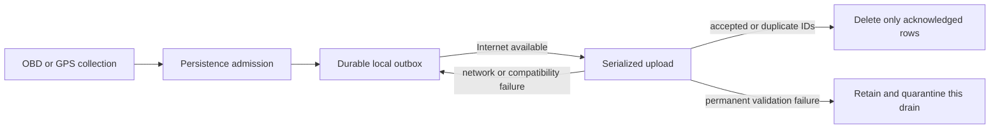
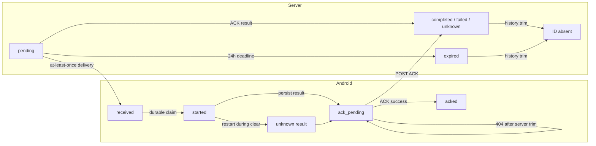
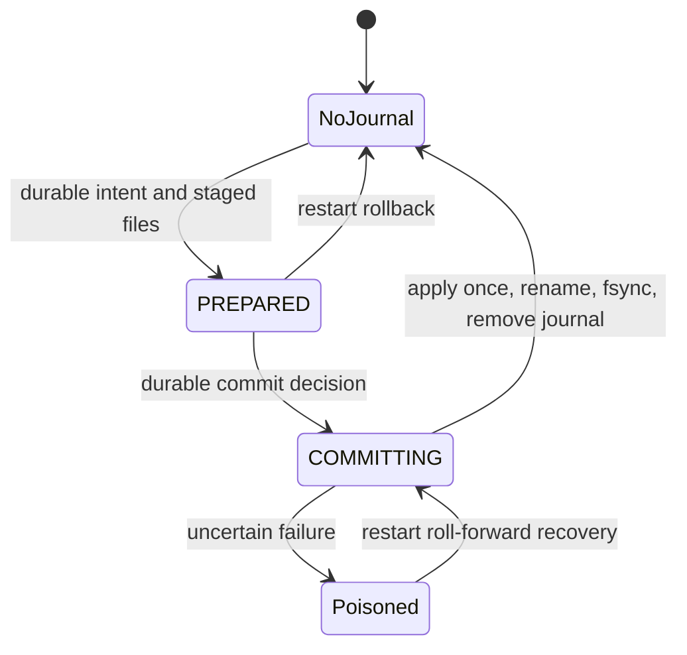

# State-machine inventory and independent review

Audited runtime source: **911668b4bb2a6d785e95b3dcfc89354eaa6d7f25**, 7 November 2026. This document changes documentation only; none of the issues below were fixed as part of the audit.

Three **GPT-6 Luna** subagents independently covered Android pipelines/probe, backend/infrastructure, and web/Android UI/Android Auto. The parent re-read the transition owners, checked cross-component contracts, corrected unsupported claims, ran existing suites, and built local reproducers.

## What is counted

**60 machine families: 48 implicit (I), 8 named/explicit (E), and 4 replay machines (R).** A family may contain resource- or screen-specific instances; these are not 60 processes, nor a count of every boolean combination. The 52 implicit/replay families are the main answer to the audit request. Named models are included to show the contracts around them.

- **I:** behavior depends on retained flags, nullable resources, jobs, cached baselines, request generations, timers or promise chains, without one authoritative transition model.
- **E:** the source names the lifecycle states or durable phases centrally. This does not imply every transition is correctly handled.
- **R:** local state advances while replaying an ordered history or framed message. The enclosing API can be pure, but the algorithm contains a real state machine.
- Pure projections and plain persisted preferences are listed separately, not inflated into additional machines. Library/OS internals and build-system dependency graphs are not enumerated.

This is a repository-wide source inventory, not proof that every possible scheduling interleaving was tested. No car, ADB device, production server, deployment, secret file or live endpoint was accessed. Local loopback tests and mock Android contexts were used.

## Parent-validated findings

| ID | Priority | Missing or incorrect transition | Evidence and bounded impact |
|---|---|---|---|
| F1 | P1 / High | Disconnect/reconnect does not invalidate every connection-scoped PID cache. | Four cached values (coolant, module voltage, fuel level, ambient temperature) and slow-PID retry deadlines survive. New GPS-only samples can carry old sensor values with new timestamps and derive alerts from them. Source-confirmed and reproduced with mock service; not observed in the car. |
| F2 | P1 / Medium | Android pairing has no expired-token terminal state. | Server expires pairing after 10 minutes and returns 404/status expired; Android handles approval only on 2xx responses and otherwise retries the same token indefinitely until cancellation. Cross-stack source-confirmed. |
| F3 | P2 / Medium | One-time connectivity registration retains the first service wakeup callback. | Same-process service restart cannot replace the closure, so reconnect wakes the old service channel and retains the old instance. Reproduced. Direct process-wide drain still runs; periodic sync still runs. Uploading is not wholly broken. |
| F4 | P2 / Medium | Server command-history eviction has no matching client ACK terminal transition. | Server retains 100 terminal tombstones; after an old ID is removed its ACK returns 404, while Android keeps ack_pending and retries indefinitely. The local result is retained, not lost. Bounded trimming reproduced; HTTP/client behavior verified in source. |
| F5 | P2 / Low | Maintenance vehicle-scope reset omits the displayed default odometer. | After vehicle A has an odometer, switching to B with no schedules/logs leaves A's value in B's input placeholder. Actual fetch function reproduced in an isolated JS context. Empty form submission still sends null; no incorrect odometer write is asserted. Fallback HTTP failure can also leave silently stale partial state. |

### Exact evidence and proposed repairs

**F1:** `OBDGatewayService.kt:609-617,647-703,844-855,873-880,896-926`. `handleObdDisconnect` clears engine load/throttle/IAT/MAP but leaves other caches. The mock reproducer seeded coolant at 112°C, module voltage at 11.4V and a retry deadline, called the actual disconnect method, and verified all three survive while engine load is cleared. Reset all connection-scoped caches/deadlines together; retain each sensor's sample time/source; require fresh OBD input before vehicle-sensor alerts or storage claims. Keep any system-voltage fallback explicitly distinguished from OBD voltage.

**F2:** `MainActivity.kt:1307-1377` versus `Server/routes/auth.js:274-281,304-326`. The Android loop ignores expiresInSeconds and all non2xx poll responses. Add waiting/approved/expired/cancelled/error states and a bounded deadline; handle 404/expired with a new-code action. Bind all dialog dismissal paths to cancellation. Related protocol risk: an approved poll token is deleted before its response is received; a lost approved response cannot be recovered by repeating that poll. Add a tested, bounded credential-delivery recovery/ack strategy rather than assuming one HTTP delivery succeeds.

**F3:** `OutboxUploader.kt:59-80` and `OBDGatewayService.kt:320-338,1111-1146`. The mock registered two service-style callbacks and invoked the actual retained callback: the first got one wakeup, the replacement got zero. Make the callback process-owned without capturing a Service, or explicitly unregister/rebind the current subscriber. Preserve intentionally independent outbox draining and define which owner stops it.

**F4:** `Server/routes/commands.js:19-25,152-163` versus `OutboxUploader.kt:651-694` and `CommandInbox.kt:44-70`. A lost ACK response or delayed device result can outlive its server tombstone. Align server idempotency retention with client retry horizon, or introduce a durable retired/unreconcilable local result state with operator visibility. Do not blindly convert 404 to success or replay a non-idempotent clear. Test lost response -> many newer terminal records -> reconnect.

**F5:** `Dashboard/pages/maintenance.tsx:71-100,129-140,451-453`. The scope-change effect resets page only; currentOdoVal is assigned only when a schedule or fuel log exists. Reset scoped display state to unknown, collect needed responses before committing them, and check request scope/abort after parsing. Treat fallback HTTP errors as failed/degraded polls. The isolated replay ran the actual transpiled fetchData for A then empty B and retained A's 10,000 km placeholder.

## Machine catalog

The source link locates the transition owner; adjacent helpers and cross-stack contracts above are part of the same family. Test names identify relevant coverage, not proof of all transitions.

### Android collection, transport, persistence and probe

| ID / type | Machine and retained state | Transitions, guards, timers and invariant | Source / relevant tests |
|---|---|---|---|
| A01 / I | **Foreground service ownership**. BootReceiver/AUTO_START_BOOT gate; foregroundReady, isRunning, stopStatus; serviceJob and connection/collector/sync/recovery jobs | Boot preference or UI start -> permission/promotion accepted -> running; late starts after rejection stay stopped; destroy cancels owned jobs. Process-wide uploader has a different owner. | [OBDGatewayService.kt:297](../AndroidApp/app/src/main/java/com/example/obdapp/OBDGatewayService.kt#L297). GatewayStartupTest; GatewayPermissionsTest; AndroidAutoPhoneRuntimeTest; successful restart ownership remains a gap |
| A02 / I | **Adapter connection, ACC suspension and reconnect**. obdConnection/socket/MAC; connectionJob; exponential retry | No adapter -> GPS-only; ACC off closes/suspends; connect -> initialize -> publish; failure -> retry 5s up to 60s. Connected ACC check 10s. | [OBDGatewayService.kt:569](../AndroidApp/app/src/main/java/com/example/obdapp/OBDGatewayService.kt#L569). Initialization/transport component tests; no complete ACC/reconnect integration test |
| A03 / I | **Adapter initialization and protocol discovery**. Progress through reset/echo/protocol/PID masks; resulting capabilities | Reset -> setup -> base mask -> advertised continuation masks -> optional protocol metadata -> ready. Cancellation aborts; outer connection machine retries. | [ObdAdapterInitialization.kt:52](../AndroidApp/app/src/main/java/com/example/obdapp/ObdAdapterInitialization.kt#L52). ObdAdapterInitializationTest; ObdCapabilitiesTest |
| A04 / I | **Prompt transaction and poisoned stream**. mutex; usable; accumulating response; monotonic deadline | Idle -> write -> await prompt -> complete; timeout/overflow/cancellation/IO failure -> unusable until new connection. Complete NO DATA does not poison. | [PromptObdConnection.kt:67](../AndroidApp/app/src/main/java/com/example/obdapp/PromptObdConnection.kt#L67). PromptObdConnectionTest; 5s timeout, 16KiB bound, 5ms cooperative waiting |
| A05 / I | **Learned reply counts and batch negotiation**. responseCountEnabled; responseCounts; batchEnabled | Protocol gates optimization; complete replies train counts; count-syntax rejection disables count mode; unsupported/malformed batches disable batching for that connection. | [PromptObdConnection.kt:35](../AndroidApp/app/src/main/java/com/example/obdapp/PromptObdConnection.kt#L35). PromptObdConnectionTest; ObdBatchReplyTest |
| A06 / I | **Optional PID availability and cache lifecycle**. cached sensor values; slowPidRetryAfter array; throttle/load/fuel retry deadlines | Eligible -> sampled or unavailable -> five-minute backoff; reconnect should reset connection-scoped state. Four caches and slow deadlines currently survive disconnect (F1). | [OBDGatewayService.kt:647](../AndroidApp/app/src/main/java/com/example/obdapp/OBDGatewayService.kt#L647). Cadence/capability tests; parent temporary disconnect reproducer confirms F1 |
| A07 / I | **Location subscription and provider selection**. locationManager; lastGpsRegistrationElapsed; lastLocationProvider | Register GPS/network; seed known fixes; prefer GPS while usable; provider disabled clears selected fix; destroy removes subscriptions; re-registration is conditional. | [OBDGatewayService.kt:341](../AndroidApp/app/src/main/java/com/example/obdapp/OBDGatewayService.kt#L341). GpsTelemetryPolicyTest covers policy, not Android provider ownership |
| A08 / I | **Latest GPS fix admission**. latest Fix including original elapsedRealtimeNanos | Accept only newer valid nonfuture fixes; coordinate view expires at 30s and speed at 3s; clear resets. Re-reading a fix never refreshes capture time. | [GpsTelemetryPolicy.kt:8](../AndroidApp/app/src/main/java/com/example/obdapp/GpsTelemetryPolicy.kt#L8). GpsTelemetryPolicyTest |
| A09 / I | **Persistence admission and heartbeat**. Last successfully persisted sample and connection/GPS baseline | First/new vehicle/meaningful change/connected engine sample -> insert; stationary GPS duplicates suppressed until 20s heartbeat. Baseline advances only after insert succeeds. | [TelemetryPersistencePolicy.kt:5](../AndroidApp/app/src/main/java/com/example/obdapp/TelemetryPersistencePolicy.kt#L5). TelemetryPersistencePolicyTest |
| A10 / I | **Sync supervisor and wakeups**. syncJob; conflated wakeup channel; syncDelay and failure/success flags; GatewayStatusStore sync projection | Unconfigured/offline/attempting -> wait or wake; failures back off up to one hour; success returns toward base schedule. Acquisition continues independently. | [OBDGatewayService.kt:401](../AndroidApp/app/src/main/java/com/example/obdapp/OBDGatewayService.kt#L401). OutboxUploaderTest covers drain; supervisor/restart wakeup integration is a gap |
| A11 / I | **Durable outbox delivery and quarantine**. Room pending rows; uploadMutex; per-drain auth/validation/incompatibility sets and progress | Queued -> upload -> match accepted/duplicate event IDs -> delete/mark synced. Network/auth/incompatible/permanent rejection retain rows; per-drain quarantine prevents hot loops. | [OutboxUploader.kt:97](../AndroidApp/app/src/main/java/com/example/obdapp/OutboxUploader.kt#L97). OutboxUploaderTest; acknowledgment before local deletion is the key invariant |
| A12 / E | **Durable command execution and result ACK**. Room received/started/ack_pending/acked, result, ackStatus, expiry | CAS claim before adapter action; expired received -> failed result; restart requeues reads but converts interrupted clears to unknown; persist result before ACK. Terminal unknown IDs currently retry forever (F4). | [CommandInbox.kt:29](../AndroidApp/app/src/main/java/com/example/obdapp/CommandInbox.kt#L29). CommandInboxTest; OutboxUploaderTest; command handler/physical restart integration remains a gap |
| A13 / I | **HTTP request, worker and socket cancellation**. Continuation; independent IO worker; HttpURLConnection; timeout/cancel hooks | Create -> connect/write/read -> return/error; caller cancellation disconnects socket and cancels worker; finally closes resources. | [HttpTransport.kt:23](../AndroidApp/app/src/main/java/com/example/obdapp/HttpTransport.kt#L23). HttpTransportTest; no real endpoint used in audit |
| A14 / I | **Estimated gear candidate confirmation**. candidate, since, samples, lastAt/lastRatio, confirmed | Invalid/unstable/new band -> reset candidate; three matching samples spanning 1s -> confirmed; current value expires after 1.5s. Empirical profile stays opt-in. | [AxiaGearEstimate.kt:6](../AndroidApp/app/src/main/java/com/example/obdapp/AxiaGearEstimate.kt#L6). AxiaGearEstimateTest; GearEstimateUiTest |
| A15 / E | **Acceleration run and completion mailbox**. IDLE/ARMED/ACCELERATING; launch/previous sample; latestCompletedTime | Arm at <=2 km/h, launch >3; finish crossing 100; abort below 5, drop >15, or >30s. Completion is harvested once. Wall-clock order is not explicitly validated. | [AccelerationTracker.kt:23](../AndroidApp/app/src/main/java/com/example/obdapp/AccelerationTracker.kt#L23). AccelerationTrackerTest; clock rollback/source-switch integration remains a gap |
| A16 / I | **Probe UI operation/export ownership**. operation Job; channel/session; finishing; pendingExport; selected adapter | Idle -> connecting/discovering/sampling -> stopped/report ready; cancellation/disconnect owns cleanup; export waits for operation stop and document result. | [ProbeActivity.kt:22](../AndroidApp/probe/src/main/java/com/example/obdprobe/ProbeActivity.kt#L22). ProbeSessionTest/ProbeProtocolTest cover internals; UI lifecycle not device-tested |
| A17 / I | **Probe Bluetooth transaction lifecycle**. socket; closed flag; watchdog; serialized command response | Connect with 15s watchdog -> transact -> prompt; timeout/IO/overflow closes link; closed link rejects future operations. Command timeouts bounded to 1-15s. | [BluetoothProbeChannel.kt:14](../AndroidApp/probe/src/main/java/com/example/obdprobe/BluetoothProbeChannel.kt#L14). Probe unit components; physical Bluetooth not used |
| A18 / I | **Probe discovery and sampling session**. Initialized channel; discovered PID set; progress/report exchanges | Allowlisted read-only initialization -> advertised mask continuation -> selected reads -> bounded report. No blind scan or automatic DTC clear. | [ProbeSession.kt:13](../AndroidApp/probe/src/main/java/com/example/obdprobe/ProbeSession.kt#L13). ProbeSessionTest; ProbeProtocolTest |
| A19 / I | **Head-unit Wi-Fi fallback cache**. cachedFallbackWifiSsid; lastFallbackWifiSsidTimestamp | Normal Wi-Fi API success invalidates fallback; otherwise cached property result reused for 60s; elapsed TTL triggers property/shell refresh. Uses wall time. | [OBDGatewayService.kt:1197](../AndroidApp/app/src/main/java/com/example/obdapp/OBDGatewayService.kt#L1197). No dedicated TTL/clock-change test found |
| A20 / E | **Room schema version migration**. Durable Room schema version; explicit migrations through version 11 | Older schema -> registered migration chain -> schema validation/open; this is data-evolution state, not a telemetry record workflow. | [AppDatabase.kt:12](../AndroidApp/app/src/main/java/com/example/obdapp/AppDatabase.kt#L12). Migration7To8JvmTest; Migration7To8Test instrumentation; Migration9To10JvmTest; Migration10To11JvmTest; some older paths remain untested |

### Android phone UI and Android Auto

| ID / type | Machine and retained state | Transitions, guards, timers and invariant | Source / relevant tests |
|---|---|---|---|
| U01 / E | **Driving-state lock and moving hold**. STATIONARY/MOVING/UNKNOWN; static last live speed/time; wasPreviouslyMoving | Fresh <=6s speed >8 -> moving; fresh lower -> stationary; stale previously moving stays locked; otherwise unknown; offline demo used only without live context. | [MainActivity.kt:137](../AndroidApp/app/src/main/java/com/example/obdapp/MainActivity.kt#L137). CockpitRegressionTest; unknown must remain locked |
| U02 / I | **Activity observation and service controls**. Registered receivers; ageTicker; lifecycle scope; service-running projection | onStart registers/ticks; onStop unregisters/cancels; start/stop updates controls. A status label is a projection, not sole service authority. | [MainActivity.kt:1610](../AndroidApp/app/src/main/java/com/example/obdapp/MainActivity.kt#L1610). MainActivityTest; CockpitRegressionTest; startup tests |
| U03 / I | **Cockpit grid, focus and mutation surfaces**. focusedSlotIndex; activeCustomizerDialog; activePresetPopup; currentScreenClass | Grid <-> focused; open/edit/confirm/close; mutation guards recheck stationary; moving restores grid and closes mutation UI; resize adapts when unfocused. | [MainActivity.kt:1047](../AndroidApp/app/src/main/java/com/example/obdapp/MainActivity.kt#L1047). CockpitRegressionTest; CockpitDashboardTest |
| U04 / I | **Widget metric/style/value history**. Metric; preferred/effective style; received/available flags; extrema/peak hold; bounded sparkline history and gauge caches | New metric resets history; same metric preserves it; style cycles; small height morphs dial -> bar; incoming null/value changes availability. Circular/linear gauge value, availability and peak/cache updates belong to this family; row visibility is a size/font projection. | [TelemetryWidgetView.kt:54](../AndroidApp/app/src/main/java/com/example/obdapp/TelemetryWidgetView.kt#L54). CockpitRegressionTest; FuelEconomyUiTest; GearEstimateUiTest; SpeedComparisonUiTest |
| U05 / I | **Demo session**. isDemoMode; demoJob; demo speed | Start once -> synthetic tick loop -> stop/cancel/reset; synthetic speed must not unlock a previously moving live session or populate trusted gear/comparison. | [MainActivity.kt:1677](../AndroidApp/app/src/main/java/com/example/obdapp/MainActivity.kt#L1677). CockpitRegressionTest; GearEstimateOfflineTest exists, not rerun on emulator in this audit |
| U06 / I | **Android pairing dialog**. pairingJob; requested code/pollToken; approved flag; dialog controls | Initiate -> wait/poll every 2.5s -> save credential/vehicle -> dismiss/start service. Cancel stops job; expired HTTP404 currently has no terminal transition (F2). | [MainActivity.kt:1247](../AndroidApp/app/src/main/java/com/example/obdapp/MainActivity.kt#L1247). Server pairing/transaction tests; client expiry UI test missing |
| U07 / I | **Secondary Activity loads and actions**. Per-Activity scope, request results/errors; Diagnostics refreshPending; trip row visibility | Fuel/Performance/Trips load/render; Diagnostics read/confirmed clear/4s coalesced refresh; Maintenance create/mark/delete. Destroy cancels scopes; these are separate instances of a request/action family. | [DiagnosticsActivity.kt:21](../AndroidApp/app/src/main/java/com/example/obdapp/DiagnosticsActivity.kt#L21). UI tests partial; also FuelActivity, TripsActivity, PerformanceActivity, MaintenanceActivity |
| U08 / I | **Android Auto session and screen refresh ownership**. Car Session/Screen lifecycle; refreshJob; last presented projection | Host creates status screen; start -> 3s status or 1s live gauge refresh; invalidate on changed projection; stop cancels refresh; destroy cancels scope; navigation pushes screen. | [DeviceStatusScreen.kt:23](../AndroidApp/app/src/androidauto/java/com/example/obdapp/car/DeviceStatusScreen.kt#L23). DeviceStatusScreenTest; LiveGaugesScreenTest; CarStatusPresenterTest; AndroidAutoPhoneRuntimeTest |

### Web dashboard, gateway and asynchronous UI

| ID / type | Machine and retained state | Transitions, guards, timers and invariant | Source / relevant tests |
|---|---|---|---|
| W01 / I | **Auth/profile and in-memory CSRF presentation**. profile/loading; API module csrfToken; login/logout request state | Mount/me -> authenticated or anonymous; response rotates CSRF; login redirects; logout clears profile and navigates even on error. Concurrent refresh generations are not explicitly modeled. | [AuthContext.tsx:27](../Dashboard/context/AuthContext.tsx#L27). session.spec.ts; e2e-auth.ts; check-auth-timeout.cjs; auth race tests not established |
| W02 / I | **Frontend authentication request gate**. Per-request upstream check, timeout and allow/deny result | Public bypass; credentials absent -> redirect/401; backend deny -> deny; required password change -> account/403; timeout/unavailable ->503. This is request lifecycle plus decision projection. | [proxy.ts:11](../Dashboard/proxy.ts#L11). session.spec.ts; check-auth-timeout.cjs |
| W03 / I | **Bounded API proxy streaming**. Body byte count; upstream request/controller; reader; client/response events | Read bounded body -> upstream -> stream/backpressure -> end; oversize413, deadline504, upstream502, disconnect -> abort/cancel. Auth bodies 64KiB, others1MiB; 15s deadline. | [[...path].ts:3](../Dashboard/pages/api/[...path].ts#L3). Gateway/auth timeout checks; backpressure/disconnect path coverage incomplete |
| W04 / I | **Visibility-aware polling and backoff**. disposed/running; controller; timer; consecutiveFailures; current task/interval refs | Visible -> non-overlapping run -> schedule; failure -> bounded jitter/backoff; hide -> abort/clear; show -> resume; cleanup -> disposed. Only rejected tasks count as failures. | [useVisibilityPolling.ts:28](../Dashboard/hooks/useVisibilityPolling.ts#L28). Browser integration checks; dedicated fake-clock lifecycle coverage not established |
| W05 / I | **Telemetry snapshot/cursor/legacy compatibility**. records Map; cursor; changesSupported tri-state; initialized; generation; latest timestamp | New scope resets generation; snapshot -> incremental pages;404/501 -> history/latest compatibility; merge event/sequence identity; bound2000; poll3s fresh/15s stale. No SSE machine exists. | [TelemetryChart.tsx:224](../Dashboard/components/TelemetryChart.tsx#L224). dashboard.spec.ts; workspace-ui.spec.ts; cursor failure interleavings need focused tests |
| W06 / I | **Page read/refresh and scope state**. Page data/loading/connection/error; current request scope; abort signal | Overview: parallel summary requests with scope checks; Fuel/Performance/Trips lists: polling result -> apply/reset; Maintenance: schedules/status then odometer fallback (F5). Common family with page-specific guards. | [overview.tsx:126](../Dashboard/pages/overview.tsx#L126). dashboard.spec.ts; workspace-ui.spec.ts; refill-diagnostics.spec.ts; see Fuel/Performance/Trips/Maintenance pages |
| W07 / I | **Form/mutation request workflows**. Editable fields; validation; loading/error/success; selected resource/vehicle | Login, account password/revoke, Garage add/edit/delete, Fuel add/delete, Maintenance create/mark/delete: validate -> request -> commit UI or error -> refresh. Resource-scoped cases remain separate instances. | [garage.tsx:10](../Dashboard/pages/garage.tsx#L10). session.spec.ts; workspace-ui.spec.ts; refill-diagnostics.spec.ts; not all duplicate-submit/interleaving cases covered |
| W08 / I | **Trip selection and detail requests**. selectedDrive; points; loading/error/section; driveAbortRef | Select -> abort prior -> load bounded series -> optional history fallback -> ready/error; close/scope change/unmount -> abort/clear. Filters/page/tabs are configuration within this owner. | [trips.tsx:117](../Dashboard/pages/trips.tsx#L117). trip-estimates.spec.ts; integration-ui-review.spec.ts |
| W09 / I | **Diagnostic command UI and DTC detail lookup**. commandLoading/commandPolling; clear confirmation; timers; active scope; code-set cache | Confirm clear or read -> enqueue for captured vehicle -> fast poll3s for60s; release button after3s; scope change clears timers/data; unchanged code set avoids lookup. | [diagnostics.tsx:154](../Dashboard/pages/diagnostics.tsx#L154). refill-diagnostics.spec.ts; server commands_protocol.test.js supplies terminal-state contract |
| W10 / I | **Map asset and instance lifecycle**. Script loading/loaded/error; Leaflet map/marker/polyline refs; disposed | Load script -> create map -> update route -> cleanup/remove; trip map times out at15s; error/disposed suppress stale work. Leaflet internals are outside this inventory. | [TripRouteMap.tsx:3](../Dashboard/components/TripRouteMap.tsx#L3). integration-ui-review.spec.ts; TelemetryChart also owns a map instance |
| W11 / I | **Dialog/focus/scroll ownership**. Open prop; captured focus; handler refs; scroll lock | Open captures focus/locks scroll; initial focus; Tab trap; Escape/close; cleanup unlocks/restores connected prior element. Multiple dialog owners remain separate instances. | [Dialog.tsx:34](../Dashboard/components/Dialog.tsx#L34). workspace-ui.spec.ts; exact focus/timer race coverage not established |
| W12 / I | **Responsive navigation menu lifecycle**. Vehicle/more/mobile menu booleans; refs; route and key/click handlers | Open/close via click, outside click, Escape, route change; deferred focus restoration. Independent menus are not a single mutually-exclusive enum. | [Navigation.tsx:29](../Dashboard/components/Navigation.tsx#L29). workspace-ui.spec.ts; keyboard/navigation coverage partial |
| W13 / I | **Vehicle-list load and persisted active scope**. vehicles; activeVehicleId; loading/error; localStorage key | Fetch -> restore valid saved vehicle/all/default; select persists scope; buildUrl follows active scope. Competing refresh/selection ordering has no generation guard; reachability not confirmed. | [VehicleContext.tsx:40](../Dashboard/context/VehicleContext.tsx#L40). Browser scope checks; selection/refresh race remains a candidate, not a confirmed defect |
| W14 / I | **Theme preference, OS following and cross-tab sync**. light/dark/light dark preference; resolvedTheme; DOM/localStorage/listeners | Initialize persisted preference; cycle System->dark->light->System; storage event changes preference; OS changes affect resolved theme only in System mode. | [ThemeContext.tsx:52](../Dashboard/context/ThemeContext.tsx#L52). theme-contrast.spec.ts; workspace-ui.spec.ts |
| W15 / I | **Dashboard pairing claim and redirect**. PIN/existing-new vehicle form; loading/error/success; redirect timer | Seed code -> submit claim -> failure or refresh vehicles/success -> delayed garage redirect. Separate from handset poll and server claim authority. | [pair.tsx:11](../Dashboard/pages/pair.tsx#L11). device_auth.test.js and transaction.test.js cover server; unmount redirect cancellation remains a low-priority design risk |

### Backend authority, recovery and storage

| ID / type | Machine and retained state | Transitions, guards, timers and invariant | Source / relevant tests |
|---|---|---|---|
| S01 / I | **Server boot, readiness and shutdown**. Loaded stores; migration/bootstrap progress; listen/closing lifecycle | Recover journal/open storage/bootstrap before serve; startup ambiguity fails closed; signal -> Fastify close -> wait writes -> close SQLite. Health is not a separate readiness FSM. | [server.js:304](../Server/server.js#L304). bootstrap.test.js; boot-guard.test.js; sqlite_startup.test.js; healthz.test.js |
| S02 / I | **Browser session lifecycle**. Process-local sessions Map: token, CSRF, createdAt, expiresAt | Login creates24h session; per-request expiry/sweep evicts; logout deletes; password change invalidates user sessions/replaces session; restart revokes all in-memory sessions. | [server.js:1264](../Server/server.js#L1264). device_auth.test.js; authorization.test.js; bootstrap.test.js; precise sweep/TTL boundary gaps remain |
| S03 / I | **First-password-change authorization gate**. Persisted mustChangePassword and password hash/salt | Bootstrap account is restricted -> durable password update clears flag -> old sessions revoked -> replacement session. Persistence failure leaves prior authority intact. | [auth.js:100](../Server/routes/auth.js#L100). bootstrap.test.js; device_auth.test.js; transaction failure coverage |
| S04 / E | **Server pairing claim/expiry/token delivery**. Volatile pairing maps; pending/claiming/approved; deadline; raw pending delivery token | Initiate -> pending -> claiming -> journal commit -> approved; errors restore pending; expiry -> removed/404; successful poll removes token mapping before sending. Client lacks expiry recovery (F2). | [auth.js:253](../Server/routes/auth.js#L253). device_auth.test.js; transaction.test.js; lost-approved-response recovery deserves a separate test |
| S05 / I | **Device credential migration/issue/revoke**. devices.json; hash/prefix/suffix; legacy token; vehicle binding | Legacy plaintext -> backed-up/hashed durable record; pairing issues token; authentication checks current device; revoke removes durable credential. Pending pairings are not durable credentials. | [server.js:1201](../Server/server.js#L1201). device_auth.test.js; transaction.test.js |
| S06 / E | **Server command queue and tombstones**. pending/completed/failed/unknown/expired; UUID; deadline; bounded terminal history | Enqueue pending; v2 delivery non-consuming; ACK transitions terminal idempotently; TTL expires; late ACK allowed only while record retained; trim100 tombstones (F4). | [commands.js:28](../Server/routes/commands.js#L28). commands.test.js; commands_protocol.test.js; commands_startup.test.js; transaction.test.js |
| S07 / I | **Global mutation serialization**. mutationTail promise chain; poison guard | New mutation waits prior completion; rejected predecessor does not stall future unrelated operations; poison is checked both before enqueue and when execution begins. | [server.js:628](../Server/server.js#L628). transaction.test.js; persist.test.js |
| S08 / I | **Per-file atomic write queue**. _writeChains by path; candidate snapshots; write/rename/fsync progress | Queue same-target writes -> atomic staged replacement -> durable completion; post-rename directory-sync failure poisons; shutdown waits outstanding chains. | [server.js:590](../Server/server.js#L590). persist.test.js; transaction.test.js |
| S09 / E | **Durable multi-store commit and recovery journal**. txn_journal.json PREPARED/COMMITTING; staged files; SQLite txn_applied markers | Prepare snapshots -> durable COMMITTING -> apply SQLite once/rename/fsync -> remove journal. Restart PREPARED rolls back; COMMITTING rolls forward; corrupt/failed recovery refuses startup. | [server.js:227](../Server/server.js#L227). transaction.test.js; sqlite_cross_store.test.js |
| S10 / E | **Poisoned process fail-closed state**. isServerPoisoned; serverPoisonError | Uncertain post-commit/persistence failure -> poison; all incoming routes including health return503; restart recovers journal. Only test helper resets live flag. | [server.js:120](../Server/server.js#L120). transaction.test.js; do not claim health stays 200 while poisoned |
| S11 / I | **SQLite authority, legacy import and schema/sequence repair**. Schema/indexes; legacy import completion marker; SQLite transaction state | New DB imports legacy rows and marker atomically; populated DB is authoritative; ambiguous existing empty DB fails closed; startup repairs sequence/index legacy shape. | [sqlite_storage.js:747](../Server/sqlite_storage.js#L747). sqlite_startup.test.js; sqlite_migration.test.js; sqlite_bounded.test.js; sqlite_cross_store.test.js |
| S12 / I | **Ingest idempotency and sequence-index coherence**. Event-key Set/unique indexes; nextIngestSeq; JSON index validity/length/tail | Validate -> unseen events accepted -> persist -> advance dedupe/sequence/index; duplicates acknowledged without new sequence; index metadata mismatch falls back to scan. Cursor is arrival order, not capture time. | [server.js:748](../Server/server.js#L748). server.test.js; sqlite_bounded.test.js; transaction.test.js |
| S13 / I | **Analytics cache revision/invalidation**. Telemetry/vehicle revisions; scoped trip/latest/bounds caches | Data/vehicle changes invalidate appropriate caches only after durable mutation; reads reuse current revision or recompute; invalidation and scope must agree across reassign/delete. | [server.js:788](../Server/server.js#L788). optimization.test.js; trip_summaries.test.js; sqlite_bounded.test.js |

### Replay state machines inside otherwise derived calculations

| ID / type | Machine and retained state | Transitions, guards, timers and invariant | Source / relevant tests |
|---|---|---|---|
| R01 / R | **Drive segmentation from ordered telemetry**. Current vehicle; currentDrive; previous endpoint; drive count | Empty -> open segment -> append; vehicle change or timestamp gap strictly  >5 minutes -> flush/new segment; end -> flush. There is NO ignition/engine/idle end-state rule here. | [server.js:1489](../Server/server.js#L1489). trip_summaries.test.js; SQLite incremental segmentation tests |
| R02 / R | **Adjacent-interval trip integration**. prevPoint/pendingPoint; timestamp counters; distance/fuel/idle coverage integrals | Buffer point; replace equal-time pending point; flush ordered interval; skip invalid or >30s interval; accumulate eligible paired coverage; finalize summary. No durable active-trip authority. | [trip_calculations.js:132](../Server/trip_calculations.js#L132). trip_calculations.test.js; incremental equivalence and coverage tests |
| R03 / R | **Full-to-full refill reconstruction**. Per-vehicle anchor; accumulatedLitres; previousOdometer | First full -> baseline; partial -> accumulate only with anchor; next full -> emit cycle/re-anchor; unknown/invalid/non-increasing odometer -> clear anchor. This is not ordinary fuel-log CRUD. | [fuel.js:7](../Server/routes/fuel.js#L7). refill_diagnostics.test.js |
| R04 / R | **ELM batch fragment and PID assembly**. Expected indexed fragments; declared payload length; byte position; decoded PID set | Header/indexed fragments -> bounded assembled bytes -> Mode41/PID fields -> exact requested set; missing/mixed/truncated/duplicate frames reject whole batch. Local invocation state, no cross-request stream ownership. | [ObdBatchReply.kt:22](../AndroidApp/app/src/main/java/com/example/obdapp/ObdBatchReply.kt#L22). ObdBatchReplyTest; PromptObdConnectionTest |

## Derived/configuration states that are easy to mistake for independent machines

| Owner | Classification and boundary |
|---|---|
| FuelConsumptionEstimate; FuelEstimateDisplay; FuelHistoryDisplay; DtcReadDisplay | Pure calculation/formatting/classification. Eligibility and display freshness are projections; retained sample/connection ownership is in the collector/Activity. |
| SpeedComparisonReading | Immutable timestamped input -> current OBD/GPS/difference projection. GPS admission history is A08; Activity retains the latest reading and U02 ages it. It has no mutable transition store of its own. |
| GatewayStatusStore / GatewaySyncState | Retained event-fed status submachine/projection owned by A10/A11, not an additional durable queue authority. setRunning(false) clears it; samples can change SYNCED to QUEUED. Android Auto must age and scope-check this projection. A01/A10/A11 remain authoritative owners. |
| CarStatusPresenter | Pure STOPPED/WAITING/CONNECTED, GPS and sync freshness projection; not a second collector or uploader. |
| DisplayClassifier / CockpitConstraintBuilder | Pure bounds/density/font/layout projection. U03 owns focus and layout mode; U04 owns preferred/effective widget style. |
| DashboardConfig; GearEstimatePrefs; VehiclePrefs; API preferences | Persisted configuration selections and fallback reads, not independent execution protocols. Changes feed A02/U03/U04/U06 and scope-dependent state. Invalid active IDs fall back on read. |
| Maintenance due labels / performance records / summary cards | Derived from dates, odometer or telemetry. Unlike the replay accumulators R01-R03, these labels alone do not own transition history. |
| Authorization helpers / health response / device fingerprint | Per-request guards, status payloads or serialization. Sessions, credential issue/revoke and process poison have separate real lifecycles. |
| Fastify rate-limit counters | Library-owned window/counter state configured in first-party routes. No distributed limiter store configured; single-server deployment is assumed. Not reimplemented or independently audited inside the dependency. |
| APK metadata/download and installer/build tooling | Read-only artifact existence/version projection or one-shot CLI/build steps. No agent job scheduler, APK updater FSM, live SSE client/server, retention worker or automatic backup lifecycle was found. Docker/Compose health/start/restart is external orchestration. |

## Three important cross-stack graphs

### Capture and upload are separate owners

The collector continues while Internet is unavailable. Adapter-offline means GPS-only acquisition; Internet-offline means local queueing. Neither condition implies the other. No arrow above means collection waits for upload.

### Diagnostic command delivery crosses two durable machines

The self-loop is F4. Interrupted reads can re-enter received; interrupted clears must never be automatically re-executed. A matching command ID in Room prevents duplicate delivery from duplicating physical action.

### Recovery journal authority

Corrupt/unrecoverable journals fail startup. Poison is process-wide and short-circuits health too; health is not evidence that poisoned writes can continue.

## What the parent corrected in subagent findings

1. Rejected an unchecked fuel-status second-byte concern: obdPidPayload explicitly requires two bytes; malformed/truncated payload tests exist.
2. Corrected claims that startup/permission/migration tests were absent. Startup rejection/socket cleanup, SDK permission rules, and several Room migrations have existing coverage; successful reconnect/callback ownership still lacks integration coverage.
3. Rejected the claim that a poisoned server health route still returns 200: the global onRequest poison hook runs first.
4. Corrected acceleration guards: arm<=2km/h, launch>3; no explicit unordered timestamp rejection. No invented acceleration guard is credited.
5. Corrected drive segmentation: gap strictly >5 minutes plus vehicle partition, not ignition/engine/idle boundaries.
6. Included the full-to-full refill and interval integration replay machines despite pure enclosing functions. Excluded stateless speed/formatting projections from the machine count.
7. Confirmed current live web data uses finite snapshot/change polling, not SSE. Confirmed agent routes only distribute APK/installer artifacts; no agent job machine exists.
8. Verified current theme System mode is encoded as 'light dark', not the literal 'system'.
9. Limited callback impact: immediate process-wide drain and periodic new-service sync still operate. Limited maintenance impact: a stale placeholder is not proof of wrong persisted odometer.
10. Kept unproven auth/vehicle refresh races, map/dialog timer cleanup and Activity navigation interleavings as test/design risks rather than confirmed vulnerabilities.

## Validation and limits

- **212 server tests passed** in 24 suites using local Node.js 26.7.0. CI targets Node24; this audit did not establish exact production-runtime parity.
- **389 Android app JVM tests passed:** 187 standard, 202 Android Auto. Full suites were rerun on the audited source; no car or emulator was used for this audit.
- **35 probe JVM tests passed.** Baseline total: 636 tests.
- **Two additional temporary Robolectric reproducers passed assertions describing the existing defects**, demonstrating cache retention and stale callback capture. These are not fixes or desired-behavior regression tests. Temporary source was removed after saving evidence outside the repo.
- Isolated local JS assertions exercised actual command tombstone trimming and the actual transpiled maintenance fetch function. No backend/remote request was needed.
- Dashboard browser tests and production/device timing were not rerun. Source-confirmed does not mean observed on the car. Existing passing tests do not cover every transition or prove absence of races.

## Remediation order

1. **P1:** repair connection-cache invalidation and pairing terminal/recovery handling, with transition-focused tests.
2. **P2:** fix connectivity subscription ownership, agree command retirement semantics, and reset/atomically commit Maintenance scoped state.
3. **P3:** make the largest implicit owners explicit: connection/sync supervisors, pairing workflow, outbox result policy and dashboard request generations. Use small typed transition functions and owner-bound cancellation; a wholesale state-machine framework rewrite is not required.
4. Add transition matrices/property tests for restart after physical action, expired/evicted ACKs, GPS/OBD loss, failed persistence, scope switch during body parsing, visibility hide/show during abort, and late backfill/duplicate capture times.

Only this inventory is changed in the repository. Fixes, deployment and device testing are separate work.

